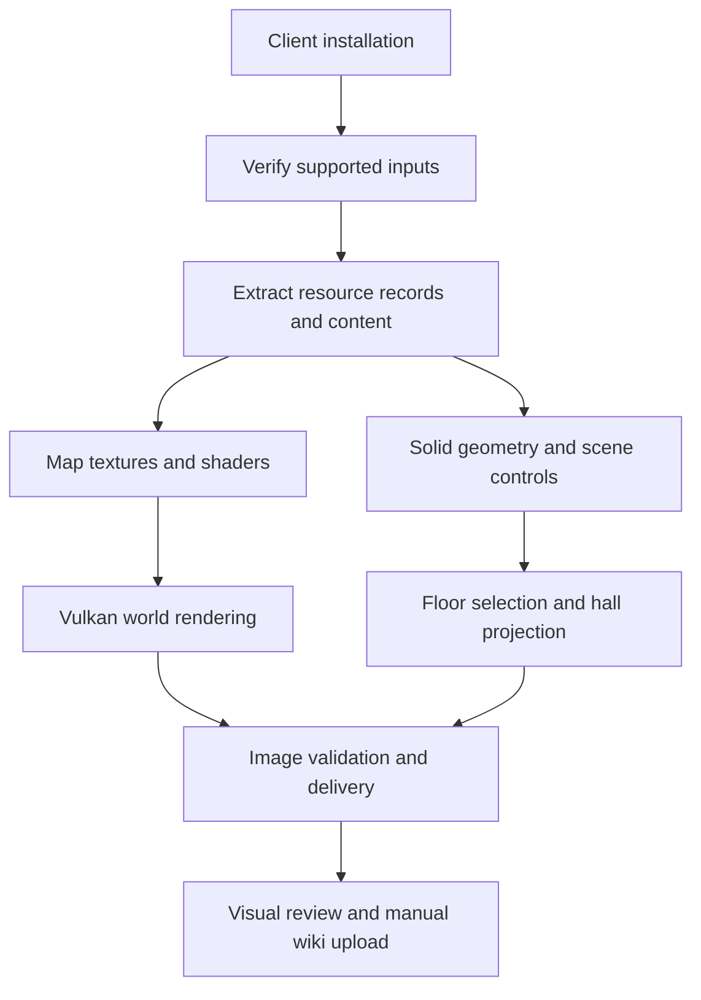

# How Enshrouded Map Tools works

Enshrouded Map Tools is an offline extraction and rendering pipeline that
generates the Embervale world background and six Hollow Halls maps from a
supported client installation. Python coordinates input verification,
extraction, rendering and delivery; a pinned archive parser and three native
helpers handle the specialized processing.

The two map types use different sources. The world background is rendered
from the game's map textures and shaders. Hollow Halls maps are generated
from solid geometry and scene data, then projected into one image per hall.
Both paths produce images, validation records and materials for manual wiki
upload. Game assets are extracted locally during generation; the distributed
package contains code, tools and build profiles.

## Components

| Component | Responsibility |
| --- | --- |
| [CLI](../enshrouded_data/map_tool/cli.py) and [core](../enshrouded_data/map_tool/core.py) | Verify the package and game inputs, manage extraction stages and record run state |
| Bundled `kfc-parser` | Decode selected resource records from the game's indexed archives |
| [World renderer](../enshrouded_data/map_tool/native/world_renderer.cpp) | Execute the extracted map shaders through Vulkan |
| [Geometry helper](../enshrouded_data/map_tool/native/hollow_geometry.cpp) | Decode solid voxel data and identify enclosed floor surfaces |
| [JPEG helper](../enshrouded_data/map_tool/native/map_jpeg.cpp) | Encode wiki derivatives and compare their decoded pixels with the PNG sources |
| [Delivery code](../enshrouded_data/map_tool/delivery.py) | Assemble images, validate files and prepare the gallery and upload metadata |

The contributor package includes the parser and compiled helpers. It requires
Windows x64 and Python 3.13, with no additional Python packages. World rendering
also requires a Vulkan device and driver that pass the renderer's capability
checks. Hall generation runs on the CPU.

## Input verification and extraction

The current [build profile](../enshrouded_data/map_tool/profiles/builds.json)
supports **unmodified client build 26430625**. It specifies SHA-256 hashes and
sizes for 58 executable, index and archive files. Verification reads the full
files, so this stage can account for a substantial part of the runtime.
Matching the executable version alone is insufficient: modified archives,
other client builds and dedicated-server inputs are rejected.

After verification, the tool uses the pinned parser to extract the selected
resource records and reads their referenced content from the installation.
Map textures, shaders, dungeon boundaries and placed scene controls all come
from that run's game files. Profiles supply identities and validation
expectations, without supplying saved geometry or previous map exports.

Extraction caches and outputs go into a separate directory. Generation makes
no network requests, launches no game process and leaves the installation
unchanged. A modded installation whose checked archives differ requires a
separate unmodified copy.

## World map rendering

The game stores its map as height and detail textures, color gradients,
Shroud textures and rendering parameters. The tool extracts those assets
along with the original compiled SPIR-V map shaders and runs them in a standalone Vulkan
renderer. It derives map settings from the executable and resource data,
using the configured contour and Shroud settings.

The [world pipeline](../enshrouded_data/map_tool/world.py) renders an **8 by 8
grid** covering the exported map extent. At the default density, each block
is 2,560 by 2,560 pixels and covers 1,280 by 1,280 world units. Increasing
pixel density changes image detail without changing geographic bounds.
Output rows run north to south.

| Layout | Delivered images |
| --- | --- |
| `single` | One 20,480 by 20,480 PNG at the default density |
| `tiles` | 64 lossless PNG tiles and 64 JPEG derivatives for wiki use |
| `both` | The master PNG and both tile sets |

All layouts render the same 64 blocks internally. For the master, delivery
code streams their decoded RGB rows into a single PNG, preserving pixels
without allocating the entire uncompressed image. JPEG derivatives retain
the tile dimensions and use quality 100 with 4:4:4 sampling. They remain
lossy, so their decoded pixels are compared with the lossless source.

The result is a static world background. Interactive wiki markers, quest
data and points of interest are maintained separately.

## Hollow Halls geometry and projection

Surface map textures cannot reveal buried rooms or stacked passages. The
[hall pipeline](../enshrouded_data/map_tool/halls.py) instead reads the game's
solid voxel geometry and scene records.

The native geometry helper samples enclosed vertical air intervals on a
half-meter grid. A candidate interval needs solid support, a solid ceiling
and at least 1.5 meters of headroom. Adjacent intervals form floor components
when they share sufficient headroom and their floor heights differ by no
more than one meter.

The tool associates those components with each hall using authored dungeon
volumes, reciprocal entrance teleporter links and placed scene controls.
Selected floors are constrained to the hall's volume boundaries. Entrance,
exit, checkpoint and applicable internal portal markers are derived from
scene references.

The [flattening renderer](../enshrouded_data/map_tool/hall_flatten.py) projects
selected surfaces onto the horizontal X/Z plane. At each position, the
highest surface supplies the primary relief shading; lower surfaces
contribute blended fill and edge detail at that same position. This retains
overlapping surfaces in a single image per hall. The six outputs are north
up at two pixels per meter, with labels and a scale bar.

The hall palette and relief are this tool's presentation of the geometry.
Stacked passages can overlap without connecting, and mesh-only props or
changing obstacles may be absent. Floor selection describes static geometry
and does not simulate player collision or traversal.

## Validation and delivery

Generation validates PNG structure, chunk checksums and decoded RGB hashes.
JPEG checks cover dimensions, encoded sampling and quality settings, and
decoded-pixel error against the PNG source. Run records bind inputs,
settings and completed outputs to their recorded hashes.

The output directory includes:

| Output | Purpose |
| --- | --- |
| `index.html` | Local gallery for visual review |
| `manual-upload.json` | Local image paths, suggested wiki filenames, descriptions and size eligibility |
| `run.json` and `inputs.json` | Run state and input verification records |
| `cache/` | Extracted records and generation intermediates |

The `verify` command checks a completed delivery against its recorded
hashes. With `--resume`, completed stages are checked before reuse and the
original package, paths and options must be retained. Some incomplete
extraction or geometry stages require a fresh output directory.

Upload eligibility uses a configured **15 MiB per-file** threshold rather
than querying the wiki. The tested world master exceeds it; JPEG tiles are
the intended wiki background output. Images are never resampled to satisfy
the threshold. Contributors review the images and current wiki limits, then
upload manually using their own accounts. Automated checks establish file
integrity and processing consistency; visual review remains necessary for
layout, orientation and seams.

## Builds and game version support

[GitHub Actions](AUTOMATION.md) compiles the native helpers, runs tests,
packages the contributor tool and checks the extracted package. Publishing
a release with a tag matching the committed package version triggers a build
and attaches the Windows ZIP and checksum. Manual runs produce downloadable
artifacts without publishing a release.

CI operates on the source and pinned dependencies. Full extraction and
rendering tests use a maintainer's supported installation and graphics
device; game archives and generated maps are excluded from the package.

Supporting a game update requires reviewing changed resources and archive
layouts, updating profiles and affected code, and validating the resulting
maps. A profile binds the tool to verified inputs; editing its build number
alone does not establish compatibility.

See [Generate and upload map images](manual-upload.md) for contributor steps,
[Building from source](BUILDING.md) for compilation and packaging, and
[Validation coverage](VALIDATION.md) for the tested behavior and limits.
